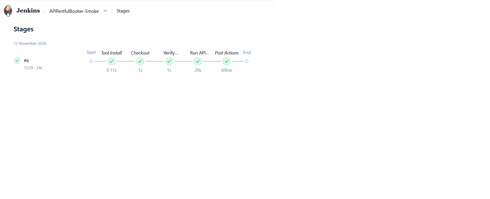
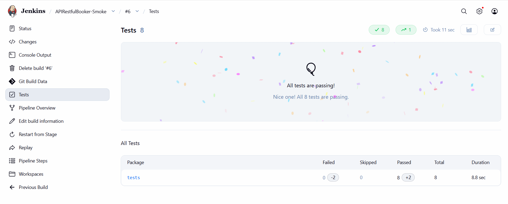

## Jenkins CI Integration

This project is integrated with Jenkins to execute API Smoke and API Regression test suites independently.

### Jenkins Pipeline Jobs

| Jenkins Job | Test Suite | Maven Profile | Execution |
|---|---|---|---|
| APIRestfulBooker-Smoke | Smoke Tests | `smoke` | `mvn clean test -Psmoke` |
| APIRestfulBooker-Regression | Regression Tests | `regression` | `mvn clean test -Pregression` |

### Pipeline Implementation

- Configured separate Jenkins Pipeline jobs for API Smoke and API Regression execution.
- Integrated the GitHub repository with Jenkins using Git SCM.
- Used dedicated Jenkinsfiles for the two execution pipelines.
- Configured JDK and Maven tools in Jenkins.
- Used Maven profiles to select the appropriate TestNG groups.
- Configured Jenkins test-result publication using Maven Surefire XML reports.

### Execution Flow

GitHub Repository → Jenkins SCM Checkout → Maven Build → TestNG Group Selection → RestAssured API Execution → Test Reports

### Jenkins Pipeline Files

- `Jenkinsfile` – API Smoke pipeline.
- `Jenkinsfile-regression` – API Regression pipeline.

## Jenkins API Smoke Execution Evidence

### Pipeline Execution

### Test Execution Results

### Complete Console Output
[View API Smoke Jenkins Console Log](docs/jenkins/api-smoke-console.txt)
